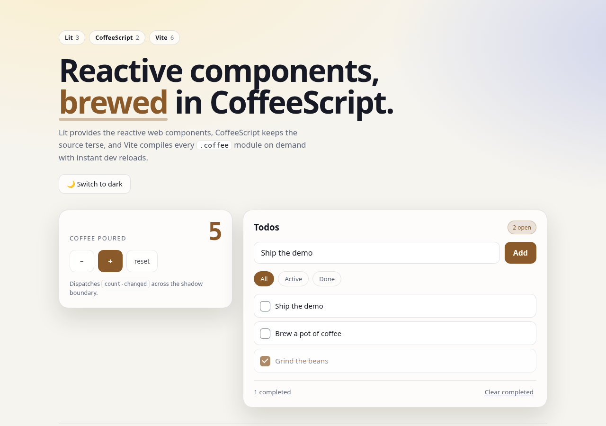

# Lit + CoffeeScript + Vite

A small, working demo of **Lit 3** web components authored in **CoffeeScript 2** and built with **Vite 6**. No React, no TypeScript, no decorators — just `.coffee` modules, shadow DOM, reactive properties and a 20-line Vite plugin.

The app itself is a "coffee counter + todo list" dashboard with light/dark theming.



## Quick start

```bash
npm install
npm run dev        # http://localhost:5173
```

Other scripts:

| Script            | What it does                                                        |
| ----------------- | ------------------------------------------------------------------- |
| `npm run build`   | Production bundle in `dist/` (minified, hashed assets)               |
| `npm run preview` | Serve the production build locally                                   |
| `npm test`        | Vitest + happy-dom: mounts the components and drives real DOM events |
| `npm run check`   | Compiles every `.coffee` file to `/tmp` as a syntax check            |
| `npm run verify`  | `check` + `test` + `build` in one shot                               |

## How CoffeeScript plugs into Vite

Vite has no built-in CoffeeScript support, so `vite.config.js` ships a tiny plugin:

```js
function coffeePlugin() {
  return {
    name: 'vite-plugin-coffeescript',
    enforce: 'pre',
    transform(source, id) {
      if (!id.endsWith('.coffee')) return null
      const compiled = CoffeeScript.compile(source, {
        bare: true,
        filename: id,
        sourceMap: true,
      })
      return { code: compiled.js, map: JSON.parse(compiled.v3SourceMap) }
    },
  }
}
```

Because it runs in the `pre` phase, CoffeeScript compiles to standard ES modules before Vite's import analysis and dependency graph run. Everything that follows is normal Vite: `?inline` CSS imports, instant dev reloads, production minification and source maps.

```
index.html            # <demo-app> + /src/main.coffee
vite.config.js        # CoffeeScript plugin + Vitest config
src/
  main.coffee         # entry: global styles + app registration
  app.coffee          # <demo-app>: layout, filters, theme, store wiring
  app.css
  app.test.coffee     # Vitest suite (written in CoffeeScript too)
  components/
    counter-card.coffee / .css   # <counter-card>: reactive counter + CustomEvent
    todo-item.coffee    / .css    # <todo-item>: checkbox row + CustomEvents
  store/
    todos.coffee      # framework-free observable TodoStore
  styles/global.css   # theme tokens, background, reset
```

## Writing Lit templates in CoffeeScript

CoffeeScript has no tagged-template-literal syntax. Lit still needs real template literals at runtime, so each `render()` holds one JavaScript block, delimited by backticks, and everything inside it is ordinary Lit markup:

```coffee
render: ->
  `html\`
    <button @click=\${() => this._bump(1)}>+</button>
    <span>\${this.count}</span>
  \``
```

The `\`` escapes let CoffeeScript's lexer know the surrounding JS block continues past the template's own backticks. Nested templates work the same way, e.g. the todo list in `src/app.coffee`:

```coffee
\${this._visible().map((todo) => html\`
  <todo-item .todo=\${todo}></todo-item>
\`)}
```

Everything else — reactive properties, state, event handlers, lifecycle, the store — is plain CoffeeScript.

### Static class fields

CoffeeScript reserves `static`, and `@properties = …` inside a class body makes the compiler wrap the class in an IIFE ending in `}).call(this)`. That top-level `this` is a warning in an ES module, so static Lit config is assigned after the class instead:

```coffee
export class CounterCard extends LitElement
  constructor: ->
    super()
    @count = 0

CounterCard.properties =
  count: { type: Number }

CounterCard.styles = [unsafeCSS(styles)]

customElements.define 'counter-card', CounterCard
```

Lit reads `properties`/`styles` when the first element is constructed, which happens only after `customElements.define`, so the assignment order is safe.

## What the demo exercises

- **Lit 3**: `LitElement`, `html`, `unsafeCSS`, reactive/state properties, `?attribute` and `.property` bindings, shadow DOM, `updateComplete`.
- **CoffeeScript 2**: classes, bound methods (`=>`), destructuring-ish spreads, `switch`, string interpolation, async test functions, and the `\`` template escape.
- **Vite 6**: a custom transform plugin, `?inline` CSS, instant dev reloads, production build with source maps.
- **Events across shadow boundaries**: `<counter-card>` emits `count-changed`; `<todo-item>` emits `todo-toggle` / `todo-remove`; both are `bubbles: true, composed: true`.
- **Tests**: `src/app.test.coffee` mounts the app, clicks the counter, adds/toggles/removes todos, filters them, and toggles the theme.

## Verification

```bash
$ npm run verify
$ npx vitest run
 Test Files  1 passed (1)
      Tests  5 passed (5)
$ npx vite build
✓ 17 modules transformed.
✓ built in ~350ms
```
